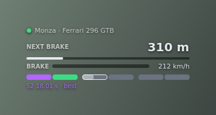
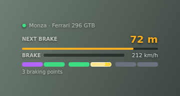
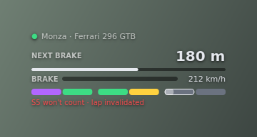

<div align="center">

# Brake Trainer EVO

**Learn your own braking points. Hear them coming.**

A companion app for **Assetto Corsa EVO** that learns where *you* brake on every track and car,
then beeps as you approach those points. A small transparent HUD shows the details.




<sub>The overlay, rendered with the app's own widgets over a placeholder background.</sub>

</div>

> [!IMPORTANT]
> **This is a heavily "vibe coded" project.** Almost all of the code and documentation was written
> by an AI assistant ([Claude](https://www.anthropic.com/claude), by Anthropic) in conversation with
> the maintainer, who steers the work and tests it in the game. It has automated tests, but it has
> not been through formal code review or long-term field testing. Expect rough edges, read the code
> before you trust it, and please report bugs. AI-assisted pull requests are welcome, with a human
> check: see [CONTRIBUTING.md](CONTRIBUTING.md) and [About this project](docs/ABOUT.md).

## Features

- **Audio cues**: a low beep shortly before each learned braking point, a high beep at the point.
  Works in every display mode, so you can keep your eyes on the road.
- **Learns by itself**: no setup per track. It watches where you start braking, keeps your best
  sectors and uses the median of your fastest runs as the cue point.
- **Per track and per car**: every combination has its own marks. A new car borrows another car's
  points as a rough starting guide.
- **Careful about what it learns**: ignores the warm-up lap, pit laps, invalidated laps and
  off-track moments, and can be **paused** during a race so your marks stay untouched.
- **Transparent HUD**: next braking point distance, live brake bar, F1-style sector colours
  and a status line. It can stay on top of the game.
- **Settings window** for everything: sounds, detection thresholds, sectors, overlay look. The Data
  tab lets you delete a single run, a sector or a whole track and car. An About tab has the credits.
- **Has its own icon** (taskbar, tray, installer).
- **Closes itself when the game exits**, and keeps a tray icon, your settings and rotating logs.

## Download

Get a build from the [Releases page](https://github.com/leonelafonsoe/brake-trainer-evo/releases):

- **`BrakeTrainerEvo-<version>-setup.exe`**: installer (current user, no admin rights needed).
- **`BrakeTrainerEvo-<version>-windows.zip`**: portable, unzip and run `BrakeTrainerEvo.exe`.
- **Nightly**: a pre-release rebuilt after every change to `main`, for trying the newest code.

The programs are not code-signed, so Windows SmartScreen may warn the first time (see
[Troubleshooting](docs/TROUBLESHOOTING.md#installing-and-running)). Each versioned release lists its
changes and has `SHA256SUMS.txt` to verify the installer and zip. The rolling Nightly pre-release
has only the portable zip.

## Quick start (from source)

Requirements: Windows 10/11, Python 3.11 or newer, Assetto Corsa EVO.

```powershell
git clone https://github.com/leonelafonsoe/brake-trainer-evo
cd brake-trainer-evo
py -m venv .venv
.venv\Scripts\Activate.ps1          # if scripts are blocked, see docs/TROUBLESHOOTING.md
pip install -e ".[dev]"
py -m brake_trainer
```

Start it before or after the game. For the overlay to show over the game, run the game in
**borderless / windowed** mode (a normal window cannot draw over exclusive fullscreen; the beeps
work either way).

### Build the executable

```powershell
py scripts/build_exe.py            # dist\BrakeTrainerEvo\BrakeTrainerEvo.exe (+ a .zip)
py scripts/build_exe.py --onefile  # a single .exe (slower start, more antivirus false alarms)
```

An installer script for [Inno Setup](https://jrsoftware.org/isinfo.php) is in `packaging/installer.iss`.
Releases are built automatically by GitHub Actions: see [docs/RELEASING.md](docs/RELEASING.md).

The folder build is recommended. Settings, learned data and logs live in
`%APPDATA%\BrakeTrainerEvo\`, so the program folder can be moved or deleted freely.

## Using it

1. **Drive out of the pits.** The first lap is a **warm-up lap**: nothing is learned (cold tyres
   and brakes make you brake early). On a track you have not driven before the app is also waiting
   for the game's sector lines from its log, and says "Waiting for the game's sector lines" while
   it does.
2. **Keep driving.** From the second lap on, each finished sector is saved if it is among your
   fastest. The sector bar fills with colours and beeps start as soon as there are marks ahead.
3. **Next time**, everything is loaded from disk and cues work from the first lap.

### The overlay

| Element | Meaning |
| --- | --- |
| Top line | Track and car, with a dot: grey = waiting for the game, amber = game running, green = live |
| NEXT BRAKE | Distance to the next learned braking point. White, then amber when the warning is due, red at the point |
| BRAKE | Your live brake pedal, with your speed |
| Sector bar | One segment per game sector, sized to that sector's real share of the lap, with a thin separator on the game's line. Grey = not driven, yellow = slower than your kept runs, green = among your fastest, purple = your fastest. A white outline marks the current sector |
| Status line | What matters right now: a sector that won't count, learning paused, warm-up, the last sector result, the reference car, or a summary |

<table>
<tr>
<td></td>
<td></td>
</tr>
<tr>
<td align="center"><sub>Approaching a braking point</sub></td>
<td align="center"><sub>The lap was invalidated: this sector won't be saved</sub></td>
</tr>
</table>

**Controls.** Drag the overlay to move it. Hover it for the pause/resume (⏸/▶), settings (⚙) and
quit (✕) buttons. Right-click for the same actions plus *Always on top* and *Reset position*. The
tray icon has the same toggles, including *Overlay click-through*. By default the overlay opens at
the top centre of the main screen.

## Documentation

| Document | What is in it |
| --- | --- |
| [How it works](docs/HOW_IT_WORKS.md) | Braking events, sectors, warm-up, what is not learned, colours, reference car |
| [Settings reference](docs/SETTINGS.md) | Every setting with defaults, ranges and what it does |
| [Troubleshooting](docs/TROUBLESHOOTING.md) | Installation problems, no overlay, no sound, nothing learned |
| [Design notes](docs/DESIGN.md) | Architecture and the reasoning behind the main decisions |
| [Development](docs/DEVELOPMENT.md) | Setup, checks, architecture map and change recipes |
| [Telemetry notes](docs/TELEMETRY.md) | Which game data is used, SDK quirks, caveats |
| [Data files](docs/DATA.md) | Where files live and the format of the learned data |
| [About this project](docs/ABOUT.md) | How it was made (AI-written), what was verified and how |
| [Releasing](docs/RELEASING.md) | How pull requests, nightly builds and versioned releases work |
| [Changelog](CHANGELOG.md) | Version history |

## Project layout

```
src/brake_trainer/
  models.py        data types
  config.py        settings (frozen dataclass, validated, JSON)
  settings_spec.py settings metadata: labels, ranges, tabs and defaults
  engine/          braking-point learning and cues (pure logic: engine, passes, lines,
                   limits, cues, constants)
  timeline.py      position history and interpolated line crossings
  storage.py       per track + car persistence
  telemetry.py     acevo-sdk adapter, restart watchdog, game-exit detection
  gamelog.py       follows the game's log for sector splits and cuts
  audio.py         generated beeps (no audio files)
  metadata.py      app/build/save provenance for stored files
  paths.py         per-user app, data and log folders
  buildinfo.py     which build this is (commit or packaged identifier)
  logsetup.py      logging: rotating file + console, verbose mode
  app.py           wiring, tray icon
  ui/              overlay, settings/ (window, form, diagnostics/data/about pages), status line,
                   icon, worker thread, theme
tests/             pytest: engine scenarios, storage, config, telemetry, status line, docs
scripts/           build_exe.py, make_icon.py, gen_settings_doc.py, release_notes.py, bump_version.py
packaging/         PyInstaller entry point, installer script, icon
.github/           CI, nightly and release workflows, issue and PR templates
docs/              documentation
```

The engine, storage and telemetry layers have no Qt dependency, so most behaviour is tested
without a display, the game or Windows.

## Development

```powershell
pip install -e ".[dev]"
ruff format .       # format
ruff check .        # lint
mypy                # type check (strict)
pytest              # tests
py scripts/gen_settings_doc.py   # regenerate docs/SETTINGS.md after changing settings
```

See [CONTRIBUTING.md](CONTRIBUTING.md) for the contribution rules and
[docs/DEVELOPMENT.md](docs/DEVELOPMENT.md) for setup, checks and change recipes. If you use an AI
agent, [AGENTS.md](AGENTS.md) is the short working guide. Pull requests are welcome.

## Limitations

- Assetto Corsa EVO is in Early Access and the telemetry SDK is alpha: data fields may change
  between game updates.
- Braking points depend on car, setup, tyres and conditions. A borrowed reference is a hint, not
  a truth.
- A braking zone very close to the start/finish line can wobble between the last and first
  sector. More in [Design notes](docs/DESIGN.md#known-limitations-and-ideas).
- Track limits follow the game. A cut notification and the lap flag are written where the game
  judged the cut, so the app drops the sector at that position and takes its run back if it was
  already saved.
  The game buffers its log (a few KB, flushed when full), so a cut can be read a minute later,
  or after the lap it belongs to has ended, and several can arrive at once; each line's own time is
  what the app attributes from, so every one still lands in its own sector of its own lap, and one
  for a lap that is over is named on the status line. An infraction it judges from something it does
  not expose cannot be pinned to a sector, and the app says so in its log. More in
  [Telemetry notes](docs/TELEMETRY.md#track-limits).
- Windows only (it uses the game's shared memory, `tasklist` and `winsound`).

## Credits

This project would not exist without the work of others:

- **[acevo-sdk](https://github.com/glebulon/acevo-sdk) by Gleb Zverinskiy** (MIT, [PyPI](https://pypi.org/project/acevo-sdk/)): the library that reads Assetto Corsa EVO's shared-memory telemetry. Every number this app uses comes through it. Thank you for making it.
- **[Brake Trainer](https://www.overtake.gg/downloads/brake-trainer.32511/) by AugGust** (OverTake.gg, 2020): the original app for the first Assetto Corsa that learns your braking points and beeps as you approach them. This project is a from-scratch reimplementation of that idea for Assetto Corsa EVO, which has no in-game app system. **No code from it was used**; the concept, the name and the audio-cue approach are all AugGust's. If you play the original Assetto Corsa, go and use theirs.
- **NaniTheCat** ([review](https://www.overtake.gg/downloads/brake-trainer.32511/review/317056/) on the original app): described keeping the best sector's braking points from valid laps and combining the best of several laps, an idea this project also builds on.
- **[PySide6 / Qt for Python](https://doc.qt.io/qtforpython-6/)** for the interface, and the maintainers of PyInstaller, pytest, ruff and mypy. See [THIRD_PARTY_NOTICES.md](THIRD_PARTY_NOTICES.md).

## Disclaimer

This is an independent, unofficial tool. It only *reads* the telemetry the game publishes; it does
not modify the game or its files. I have not checked the game's terms or any server's rules about
telemetry tools in online sessions, so use it at your own risk and check before using it online.
"Assetto Corsa" is a trademark of its owners and this project is not affiliated with them.

## License

[PolyForm Noncommercial License 1.0.0](LICENSE). In plain words: you are free to use, copy, modify,
fork and share this software, and to send pull requests, for any **non-commercial** purpose
(personal use, hobby projects, learning, charities, schools and so on). You may **not sell it or
use it for commercial purposes**. If you share it, keep the license and the `Required Notice` line
in [LICENSE](LICENSE). The license text is the legally binding part; this paragraph is only a
summary. Third-party components are listed in [THIRD_PARTY_NOTICES.md](THIRD_PARTY_NOTICES.md).
