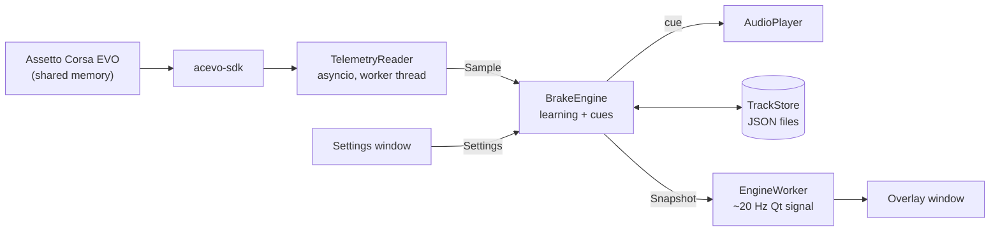

# Design notes

Why the app is built the way it is. Useful if you want to change something, send a pull request,
or just understand the trade-offs. For behaviour, see [HOW_IT_WORKS.md](HOW_IT_WORKS.md).

The idea comes from [Brake Trainer](https://www.overtake.gg/downloads/brake-trainer.32511/) by AugGust for the original Assetto Corsa; this is an independent reimplementation for Assetto Corsa EVO (see the credits in the [README](../README.md#credits)).

## Architecture

| Layer | Modules | Rules |
| --- | --- | --- |
| Pure logic | `models`, `config`, `engine`, `storage` | No Qt. Fully unit-tested with synthetic laps. |
| Adapters | `telemetry`, `audio` | The only code that touches the game, the SDK, `tasklist` or `winsound`. Everything is injectable for tests. |
| UI | `ui/*`, `app` | Thin. `ui/status.py` holds the status-line logic as a pure function so it is testable without Qt. |

**Threads.** The telemetry loop and the engine run on one worker thread (an asyncio loop inside a
`QThread`). The UI thread never touches the engine; it receives immutable `ViewState` objects
through a Qt signal. Settings are an immutable (frozen) dataclass: the UI builds a new one and
swaps the reference, which is atomic in CPython, and the engine picks it up on the next sample.

## Decisions

### An external program, not a mod
Assetto Corsa EVO has no equivalent of the original game's in-process Python app system, so the
trainer reads telemetry from outside (through `acevo-sdk`). It does not inject code, hook the
renderer or touch game files, which also avoids anything an anti-cheat could object to. The cost
is that a normal window cannot draw over exclusive fullscreen; run the game in borderless mode.

### Sound first
Beeps work in every display mode and do not distract. The overlay is a secondary aid.

### Data is per track *and* car
Braking points depend heavily on the car. One JSON file per combination keeps things simple and
lets you delete or share a single entry.

### Sectors, and a median of the best runs
A single lap's braking points are noisy, and averaging every lap includes your worst ones.
Keeping the 3 fastest runs of each sector and taking the median:

- follows your *good* driving, so the marks improve as you do;
- ignores one lucky or risky run;
- saves a sector the moment it is done, so a crash later in the lap loses nothing.

**Sector length** (about 1 km): timing has a resolution of one telemetry sample, so a very short
sector is mostly noise, and a sector is also faster if you simply *entered* it faster. Around
20-30 seconds per sector is a balance. The count is automatic (3 to 8) and can be fixed.

### Warm-up laps are ignored
Cold tyres and brakes mean earlier braking, and on a new track you are still learning the
circuit. Those marks would bias everything. The "keep the fastest runs" rule alone is not enough
on a track with no data, where those first laps are the *only* data. After a pit stop the car is
cold again, so the warm-up repeats.

### Sector lines surveyed on the warm-up lap
With equal splits a corner on a line is filed under whichever sector it began in, flipping
between them. Each sector can then see it in fewer than half of its runs and the corner gets no
cue (about 1 session in 10 in a simulation with 15 m of braking variation). Worse, a sector is
judged only by its time, so braking late can win time in one sector and lose it in the next while
the late braking point is still saved. Putting the lines on straights avoids both. The warm-up
lap is free to use for this because nothing is learned on it anyway.

### The reference car is the one with the most data
A new car borrows braking points from another car on the same track. Choosing the *fastest* car
would hand a slow car the latest braking points; the one with the most data is the most reliable.
Borrowed points are matched by track position, not by sector number, so they work even when the other
car uses different sector lines (for example data from before 0.3.5, which does not stop a new car
from getting properly placed lines). They are used only until the new car has 2 runs of that
sector and are never saved into its file.

### Validity checks use the game's own flags
`is_valid_lap` and the number of tyres off track come from the game, so track-limit rules match
what the sim enforces. The sector where the lap *became* invalid is dropped; later sectors are kept
because they can be driven cleanly.

The catch is that the flag only *drops once* per lap: after that it says nothing about a second
mistake. Counting only that drop would save a later sector with a cut in it, and a cut is usually
faster, so it would become the "best" run and drag the braking points with it.

The proper answer is the game's own per-violation event. The game writes each change in the number of
tyres off the track, with the distance beyond the line, to its log, and (per the SDK's analysis) it
invalidates a lap when all four tyres are out by 2 m or more. The app follows that log
(`gamelog.py`), so every violation is seen as an event, whatever the lap flag already says. The
tyre count in shared memory is kept as a backup. A first attempt used a lower tyre limit after the lap
was invalid; that goes beyond the game's own rule, so it is now off by default.

The log can arrive a moment after the event, so a violation also takes back a sector that closed in
the last second. The cost of relying on a log is that its location and format are those of an alpha
game; if they change the signal is lost, which is why the other checks stay.

### Pausing learning
In a race you want the marks to stay as they are. Paused mode keeps cues and sector colours
(useful feedback) but changes nothing on disk. A partly paused sector is dropped so a sector never
holds half its braking points.

### Transparent HUD
The overlay matches the minimal in-game HUD: no panel, text with a soft shadow, bars with a dark
translucent track. A near-invisible fill keeps the window grabbable (fully transparent pixels let
clicks fall through to the game). Click-through is optional, with a tray icon as the way back.

### Editing stored data goes through the engine
The running engine keeps the current track and car in memory and saves it after every accepted sector.
If the settings window changed the files directly, the engine would write its old copy straight back
and undo the deletion (also when quitting). So the UI only *requests* an edit; the worker thread
applies it between samples and reloads the entry if it is the one in use.

### Game exit
A Windows process handle makes the exit instant and costs nothing while the game runs, unlike listing
processes. It is opened once the game is found. Where that is refused, polling `tasklist` every second
is the fallback. An unknown state (cannot list processes) never closes the app.

### Executable and installer
PyInstaller, folder build by default: faster start and fewer antivirus false positives than a
single file, and it keeps Qt as separate files (see [THIRD_PARTY_NOTICES.md](../THIRD_PARTY_NOTICES.md)).

### Testing
A synthetic `Driver` (in `tests/conftest.py`) drives the engine around a fake track with braking
zones at chosen positions, with optional jitter, invalidation, off-track samples and pit
stops. Almost every behaviour in this project has a scenario test built on it. The telemetry
reader is tested against a fake capture object.

## Known limitations and ideas

- A braking zone within ~150 m of the start/finish line can still wobble between the last and
  first sector (the line cannot move without changing the lap logic).
- The game may flag a lap a moment after the mistake; if that crosses a sector line, the next
  sector is dropped instead.
- Cues are position-based. A different racing line, or a damaged or very different setup, shifts
  the real braking point.
- Possible future work: learning per corner instead of per sector, custom WAV sounds, importing
  and exporting data, a per-car sound profile, localisation, a signed installer.
