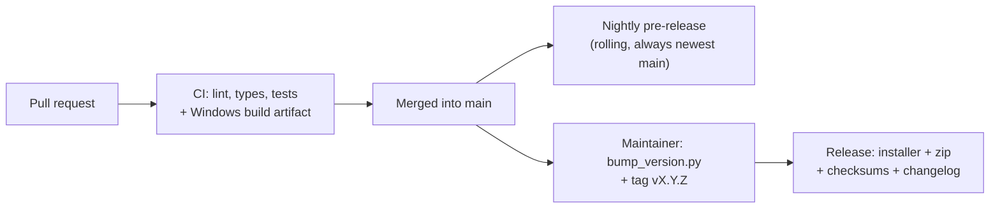

# Development

How to set up, run, test and change Brake Trainer EVO. For the rules of a contribution and the
AI-assisted policy, see [CONTRIBUTING.md](../CONTRIBUTING.md). For the architecture and the reasons
behind it, see [DESIGN.md](DESIGN.md).

## Setup

Python **3.11+** is required. The app runs on Windows, but the engine and almost all tests run on
Linux and macOS.

```powershell
# Windows
git clone <your fork>
cd brake-trainer-evo
uv sync --extra dev                 # creates .venv from uv.lock
```

```bash
# Linux/macOS
git clone <your fork>
cd brake-trainer-evo
uv sync --extra dev
uv run pre-commit install           # optional: mirror the checks on every commit
export QT_QPA_PLATFORM=offscreen    # the UI tests must not need a display
```

The `dev` extra installs pytest, coverage, ruff, mypy and PyInstaller. `uv.lock` pins the exact
resolved versions; CI uses `uv sync --locked --extra dev`, which fails if `uv.lock` is stale, so a
dependency change must be committed with its lock. The runtime dependencies are PySide6 and
`acevo-sdk` (pinned below 0.2.0; see the comment in `pyproject.toml`).

## Run from source

```bash
uv run python -m brake_trainer
# or:
uv run brake-trainer
```

On Linux and macOS the UI runs, but telemetry and audio are Windows-only: the game's shared
memory, `tasklist` and `winsound` are not available. Use the tests to exercise those paths.

To keep test data out of your real profile, point the app at a scratch folder:

```bash
BRAKE_TRAINER_HOME=/tmp/brake-trainer-dev uv run python -m brake_trainer
```

## Checks

Run the same gates as CI (`.github/actions/gates/action.yml`):

```bash
uv sync --locked --extra dev
uv run pre-commit run --all-files  # ruff, formatting, YAML/TOML, whitespace, mypy
uv run ruff format --check .
uv run ruff check .
uv run mypy
uv run mypy --platform win32   # the Windows-only branches (ctypes, winsound, tasklist)
uv run pytest -q -W error
uv run pytest -q -W error --cov    # coverage with the floor from pyproject.toml
uv run python scripts/gen_settings_doc.py --check
```

Before tagging a release, also run

```bash
uv run python scripts/release_notes.py --tag vX.Y.Z --check
```

Use `uv run ruff format .` to apply formatting, and `uv run python scripts/gen_settings_doc.py` to
regenerate the settings reference after changing a setting.

- **Warnings are errors.** `filterwarnings = ["error"]` makes any warning fail the run. Fix the
  cause; do not filter it away unless a dependency cannot be fixed.
- **Every test has a 60-second timeout.** A hanging test fails instead of blocking CI.
- **Coverage is a floor, not a target.** It lives in `pyproject.toml`; raise it when coverage
  improves, never lower it to let a change through.
- **Strict config and markers.** `--strict-config --strict-markers` rejects a typo in
  `pyproject.toml` or an unregistered `@pytest.mark`.
- **Dependency audit.** `.github/workflows/security.yml` runs `pip-audit` against the exported
  `uv.lock` weekly and when dependencies change.

## Where the tests live

| Area | Tests |
| --- | --- |
| Engine, sectors, cues, early passes | `tests/test_engine_learning.py`, `tests/test_sector_lines.py`, `tests/test_track_limits.py`, `tests/test_data_edits.py` |
| Storage, save failures and stored/legacy data | `tests/test_engine_storage.py`, `tests/test_config_storage.py` |
| Position history and crossings | `tests/test_timeline.py` |
| Game-log parsing and tail lifecycle | `tests/test_gamelog_parser.py`, `tests/test_gamelog_tail.py` |
| Cut attribution from the log and the engine | `tests/test_cut_attribution.py` |
| Replayable trace through the real engine | `tests/replay.py`, `tests/test_replay_harness.py` |
| Telemetry reader, audio, process probing | `tests/test_telemetry_audio.py` |
| Worker thread, queueing, shutdown | `tests/test_worker.py` |
| Overlay states and settings form | `tests/test_overlay.py`, `tests/test_settings_window.py` |
| Tray vs dialog save-failure warning | `tests/test_notifications.py` |
| Composition root, single instance | `tests/test_app.py` |
| Pure layers do not import Qt/adapters | `tests/test_architecture.py` |
| Settings application, save warnings, shutdown | `tests/test_controller.py` |
| Global pause hotkey parsing and registration | `tests/test_hotkey.py` |
| Status line and widget geometry | `tests/test_status.py`, `tests/test_widgets.py` |
| Docs, links, release tools, generated files | `tests/test_docs.py`, `tests/test_docs_links.py`, `tests/test_release_tools.py` |

Four adapters have a real implementation only on Windows: the process handle
(`open_process_watcher`), `winsound`, the single-instance mutex and the global pause hotkey
(`RegisterHotKey` with the `WM_HOTKEY` filter). Their tests are marked
`skipif(sys.platform != "win32")`, so the Windows CI leg exercises the real code and Linux/macOS
skip them cleanly. The logic around them (an injected watcher, a fake `ctypes`, the hotkey parser
and register/unregister lifecycle) is still tested on every platform.

`tests/conftest.py` has the fixtures that make a scenario short:

- `Driver` drives a synthetic track through the real engine at 30 Hz.
- `store` is a `TrackStore` in a temporary directory.
- `qapp` creates one offscreen `QApplication`; `close_qt_windows` destroys widgets before Qt
  teardown. A widget test module marks itself with
  `pytestmark = pytest.mark.usefixtures("close_qt_windows")`.
- `make_engine` builds an engine with warm-up and game-log following off for deterministic tests.

Do not use fixed sleeps for asynchronous behaviour. `GameLogTail.poll_once()` is the seam for a
single read, and `threading.Event`/`asyncio.Event`/condition polling replace guessed delays.

## Architecture map

```
src/brake_trainer/
  models.py       data types (Sample, Snapshot, TrackData, ViewState)
  config.py       Settings, clamping, atomic settings persistence
  settings_spec.py settings metadata: labels, ranges, tabs, defaults
  timeline.py     position history, interpolation, crossing detection
  engine/         learning, sector timing, cues (pure logic)
    __init__.py   the public import path: explicit re-exports only
    engine.py     BrakeEngine: session, storage, update and snapshot
    passes.py     the sector pass in progress and closing it
    lines.py      the game's sector lines, learned from its split log
    limits.py     braking zones and the game's track-limit signals
    cues.py       braking events and the cues they produce
    constants.py  shared constants (a leaf module)
  fileio.py       one atomic JSON writer (temp file, fsync, replace)
  storage.py      per track + car JSON, quarantine, atomic saves
  metadata.py     app/build/save provenance
  buildinfo.py    which build is running
  paths.py        per-user folders
  telemetry.py    acevo-sdk adapter, restart watchdog, game-exit detection
  gamelog.py      follows the game's log for splits and cuts
  audio.py        generated beeps
  logsetup.py     rotating log and verbose mode
  ui/             overlay, settings/ (window, form, diagnostics/data/about pages), status line,
                  widgets, worker, theme, icon, notifications
  controller.py   settings application and shutdown policy (no Qt)
  app.py          wiring and tray icon
```

Boundaries:

- **Pure logic** (`models`, `config`, `timeline`, `engine`, `storage`) never imports Qt. The engine
  takes its only I/O through the injected `TrackStore`.
- **Settings metadata** (`settings_spec`) is pure and Qt-free; `config`, the settings window and the
  docs generator all read the same registry.
- **Adapters** (`telemetry`, `gamelog`, `audio`, `paths`, `buildinfo`) own the outside world. Inject
  their side effects so tests need no game, display or Windows.
- **UI** (`ui/*`, `app`) is thin. `ui/status.py` is a pure function over `Snapshot` and `Settings`.
- The worker thread owns the engine. The UI queues `Settings` and `DataEdit` values and receives
  immutable `ViewState` objects; see "Threading" in [DESIGN.md](DESIGN.md#architecture).

## Change recipes

### A new setting

1. Add a `SettingSpec` to `src/brake_trainer/settings_spec.py` (name, kind, default, tab, label,
   bounds, step, suffix, help).
2. Add the matching typed field to `Settings` in `src/brake_trainer/config.py`, using
   `DEFAULTS["name"]`.
3. Regenerate the reference: `uv run python scripts/gen_settings_doc.py`.
4. Add the registry/kind/range assertions in `tests/test_settings_spec.py` and the form assertions
   in `tests/test_settings_window.py`.
5. If the engine reads it while running, handle it in `BrakeEngine.apply_settings` and test the
   live change. Every setting is documented as live; keep that true.
6. Add the changelog line and update `docs/SETTINGS.md` (generated) or `docs/GUIDE.md`.

### The game-log parser

1. Start from the real line(s), not from a guess. Add the smallest anonymized excerpt under
   `tests/fixtures/game_log/` and record the game/app build in that folder's README.
2. Teach `parse_line`/`line_time` in `src/brake_trainer/gamelog.py`.
3. Test the parser directly (one behaviour per fixture) and, if the tail should react, the
   `GameLogTail` path with `poll_once()`.
4. Keep the line's own timestamp as the attribution time. Never substitute the read time for a
   buffered event.
5. Update `docs/GAME_DATA.md` (format and caveats) and, if the driver sees a change,
   `docs/GUIDE.md`.

### Learning, sectors or cues

1. Build the scenario with the synthetic `Driver` in `tests/conftest.py`; use a real fixture only
   when the question is "what did an older build store?".
2. Crossings are interpolated between the two telemetry frames either side of the event's own
   time. Do not snap to the nearest frame.
3. Cover the boundary you touch: a sector line, a jump/teleport, a deferred line, a cut, a warm-up
   or a pause.
4. Update `docs/GUIDE.md` for behaviour and `docs/DESIGN.md` if the reason changes.

### Storage or data schema

1. If `TrackData.to_dict` becomes unreadable to an older build, bump `DATA_VERSION` in
   `src/brake_trainer/models.py`. Do not bump it for a field an older build can ignore.
2. Keep an old fixture loading and add a round-trip/migration test.
3. File names are readable hints, not identity: the names inside the JSON are. A colliding slug
   gets a `--<hash>` suffix; never let two track/car pairs share a path. A `DeleteRun` names the
   run by time and onsets, not time alone.
4. Preserve the safety rules: never overwrite an unreadable file, quarantine by move, block saves
   if the move fails, and report a failed write.
5. Update `docs/GAME_DATA.md`.

For settings, bump `SETTINGS_VERSION` when renaming or retiring keys. A file with another version
is archived and the app starts from defaults; there is no migration code to keep.

### UI

1. Add an offscreen test. Feed `ViewState`/`Settings` in and assert the text, colour class or flag
   that changed.
2. Widget test modules use `pytestmark = pytest.mark.usefixtures("close_qt_windows")` so Qt
   destroys the windows before the interpreter exits.
3. Do not mutate the engine from the UI thread: queue a `Settings` or `DataEdit` through
   `EngineWorker`.
4. Keep decisions (what the status line says, which sector is current) in pure functions where
   possible.

### Release

1. Put the user-facing changes under `## Unreleased` in `CHANGELOG.md`.
2. `uv run python scripts/bump_version.py X.Y.Z` (updates `pyproject.toml`, `__init__.py`, `uv.lock`
   and the changelog date/section).
3. Run every gate above, including
   `uv run python scripts/release_notes.py --tag vX.Y.Z --check`.
4. Commit, tag `vX.Y.Z` and push the tag. Pre-releases use the hyphen form (`v0.4.0-rc1`).
5. Watch the Release workflow; it fails closed if the installer, zip or checksums are missing or
   do not verify.

The sections below explain what each workflow does and why.

## Fixtures and real evidence

A change that depends on what the game or an older app wrote must start from that real file. Keep
the smallest excerpt that proves one behaviour under `tests/fixtures/`:

- `game_log/` — parser inputs (notification block, split, connection line).
- `track_data/` — real stored `version: 1` JSON for loader/round-trip tests.
- `settings/` — real settings JSON from older versions, proving an unknown layout is archived.

Remove names, Steam IDs, car IDs and paths; never commit a full session log. Add a new fixture
instead of silently replacing an old one, and note the game/app build in the folder README. App
logs are evidence, not test input. The full rules are in [CONTRIBUTING.md](../CONTRIBUTING.md).

## Debugging

- **Startup line.** The log opens with one structured line: `app=`, `build=`, `settings_version=`,
  `data_version=`, `debug=` and `log=`. Ask for it in a bug report.
- **Verbose logging.** Settings → Diagnostics → *Verbose (debug) logging* traces the game's
  track-limit signals (lap flag, race-cut pair, every cut read from the log) and its log lines.
- **Folders.** Settings → Diagnostics opens the app log folder, the game's log folder and the data
  folder. `BRAKE_TRAINER_HOME` overrides the app folder; the default is
  `%APPDATA%\BrakeTrainerEvo`.
- **Unreadable data.** Settings → Data lists files the app could not read, whether each was moved
  to `data/quarantine/` or left read-only, and why.
- **A failed save or telemetry read** is on the status line (`ViewState.error` /
  `Snapshot.storage_warning`) and in the log. It clears on the next success; it is not a one-off
  toast.
- **The game buffers its log.** A cut can appear a minute late, or after the lap it belongs to has
  ended. Each line's own timestamp is what attributes it; the status line names a late cut instead
  of greying the wrong lap.

## Release pipeline

Everything is done by GitHub Actions (`.github/workflows/`); no secrets are needed beyond the
built-in `GITHUB_TOKEN`.



### Pull requests (`ci.yml`)

Every pull request runs the shared gates (`.github/actions/gates`) on Linux: pre-commit, format
check, lint, mypy and the generated settings reference. The tests run on Linux with Python 3.11 and
3.12 and on Windows with 3.12, then the Windows program is built. The build is attached to the
workflow run as an artifact (kept 14 days) so anyone can download and try the change. Nothing is
published, and a failure on any operating system blocks the build. The packaged program is started
once with a temporary app folder, must write its `startup app=` line and must stay running for a
moment afterwards before the build is accepted: a crash in the first event of the event loop (a
broken native filter, for example) fails the build. Coverage is measured on the Linux 3.12 leg,
must stay above the floor in `pyproject.toml`, and is uploaded as `coverage-xml`.

### Nightly (`nightly.yml`)

On every push to `main` (for example a merged pull request) a pre-release called **Nightly (latest
main)** is refreshed. It runs the same gates as CI, including the coverage floor and a
`pip-audit` of the locked dependencies, so a nightly cannot publish code that would fail a pull
request; then the `nightly` tag moves to the new commit and the asset
`BrakeTrainerEvo-nightly-windows.zip` is replaced. Its description lists the `## Unreleased`
section of the changelog. It is for trying new code; it may be unstable.

### Versioned release (`release.yml`)

Pushing a tag like `vX.Y.Z` publishes a release with the changelog as its description and these
files:

| File | What |
| --- | --- |
| `BrakeTrainerEvo-<version>-setup.exe` | Installer (Inno Setup, per user, no admin) |
| `BrakeTrainerEvo-<version>-windows.zip` | Portable folder build |
| `SHA256SUMS.txt` | Checksums |

The zip and the installed copy also contain `LICENSE`, `THIRD_PARTY_NOTICES.md` and `licenses/`
with the third-party texts.

Pre-release tags use a hyphen (for example `v0.4.0-rc1`) and are published as **pre-releases**.
`release_notes.py` also accepts the compact `v0.4.0rc1` form for local checks, but the workflow's
pre-release flag only recognises the hyphen form, so use the hyphen when tagging.

The workflow fails closed: it stops if the installer cannot be built, if the portable zip, the
installer or the checksum file is missing or empty, or if a checksum does not match the file it
names. The executable is stamped with the tag's commit, so `build=` in the log and in every saved
file identifies the exact code even when the version number is reused. It also refuses to publish
if the tag does not match the project version, if the changelog has no notes for that version, or if
`## Unreleased` still has notes (bump first, so the release body cannot be stale). Release runs the
same coverage and dependency-audit gates as Nightly.

### Trying it safely

Push a throwaway pre-release tag such as `v0.4.0-rc1` first (after a bump to `0.4.0rc1`), or try the
whole thing in a scratch fork. Delete a bad release and its tag from the Releases page and with
`git push --delete origin <tag>`.

### Release notes

- The programs are **not code-signed**, so Windows SmartScreen may warn. Code signing needs a
  certificate (paid); a service such as SignPath offers free signing for open-source projects and
  could be added to `release.yml` later. The licence here is non-commercial, which may affect
  eligibility, so check their terms.
- Fork pull requests run the same checks, but GitHub may ask a maintainer to approve the run first.

## Repository tools

| Script | Use |
| --- | --- |
| `scripts/gen_settings_doc.py` | Rebuild `docs/SETTINGS.md`; `--check` is a CI gate. |
| `scripts/release_notes.py` | Print or check the changelog section for a tag (`--tag`, `--check`, `--out`). |
| `scripts/bump_version.py` | Update the version in both places, `uv.lock` and the changelog. |
| `scripts/build_exe.py` | PyInstaller build (Windows); bakes in `build-id.txt`. |
| `scripts/make_icon.py` | Regenerate `packaging/icon.ico`. |

## Documentation map

- [GUIDE.md](GUIDE.md) — behaviour and troubleshooting.
- [DESIGN.md](DESIGN.md) — why.
- [GAME_DATA.md](GAME_DATA.md) — SDK, game log, file formats and compatibility.
- [ROADMAP.md](ROADMAP.md) — pending work and open decisions.
- [SETTINGS.md](SETTINGS.md) — generated settings reference; never hand-edit.

Keep each page owning one job and link instead of repeating a long explanation.
