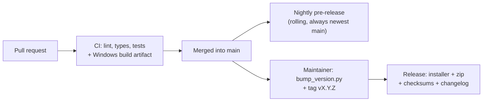

# Releasing

How pull requests turn into downloadable builds and versioned releases. Everything is done by
GitHub Actions (`.github/workflows/`); no secrets are needed beyond the built-in `GITHUB_TOKEN`.



## 1. Pull requests (`ci.yml`)

Every pull request runs the shared gates (`.github/actions/gates`) on Linux: format check, lint,
mypy and the generated settings reference. The tests run on Linux with Python 3.11 and 3.12 and on
Windows with 3.12, then the Windows program is built. The build is attached to the workflow run as
an artifact (kept 14 days) so anyone can download and try the change. Nothing is published, and a
failure on any operating system blocks the build. Coverage is measured on the Linux 3.12 leg, must
stay above the floor in `pyproject.toml`, and is uploaded as `coverage-xml`.

## 2. Nightly (`nightly.yml`)

On every push to `main` (for example a merged pull request) a pre-release called **Nightly (latest
main)** is refreshed. It runs the same gates as CI first, so a nightly cannot publish code that
would fail a pull request; then the `nightly` tag moves to the new commit and the asset
`BrakeTrainerEvo-nightly-windows.zip` is replaced. Its description lists the `## Unreleased`
section of the changelog. It is for trying new code; it may be unstable.

## 3. Versioned release (`release.yml`)

Pushing a tag like `v0.4.0` publishes a release with the changelog as its description and these
files:

| File | What |
| --- | --- |
| `BrakeTrainerEvo-<version>-setup.exe` | Installer (Inno Setup, per user, no admin) |
| `BrakeTrainerEvo-<version>-windows.zip` | Portable folder build |
| `SHA256SUMS.txt` | Checksums |

The zip and the installed copy also contain `LICENSE`, `THIRD_PARTY_NOTICES.md` and `licenses/`
with the third-party texts.

Pre-release tags use a hyphen (for example `v0.4.0-rc1`) and are published as **pre-releases**.
`release_notes.py` also accepts the compact `v0.4.0rc1` form for local checks, but the workflow's
pre-release flag only recognises the hyphen form, so use the hyphen when tagging.

### Steps

1. Keep adding notes under `## Unreleased` in `CHANGELOG.md` as changes land.
2. Prepare the release (sets the version in `pyproject.toml`, `__init__.py` and `uv.lock`, and turns
   `## Unreleased` into `## <version> - <date>`, leaving a new empty `## Unreleased`):

   ```powershell
   uv run python scripts/bump_version.py X.Y.Z
   ```

3. Review the diff, commit it (a small pull request is fine), and merge to `main`.
4. Tag and push:

   ```powershell
   git checkout main
   git pull
   git tag vX.Y.Z
   git push origin vX.Y.Z
   ```

5. Watch the *Release* run on the Actions tab. When it finishes the release appears on the
   Releases page.

The workflow fails closed: it stops if the installer cannot be built, if the portable zip, the
installer or the checksum file is missing or empty, or if a checksum does not match the file it
names. The executable is stamped with the tag's commit, so `build=` in the log and in every saved
file identifies the exact code even when the version number is reused. The workflow refuses to
publish if the tag does not match the version in the project, if the changelog has no notes for that
version, or if `## Unreleased` still has notes (bump first, so the release body cannot be stale).
`uv run python scripts/release_notes.py --tag v0.4.0 --check` runs the same check locally.

### Trying it safely

Push a throwaway pre-release tag such as `v0.4.0-rc1` first (after a bump to `0.4.0rc1`), or try the
whole thing in a scratch fork. Delete a bad release and its tag from the Releases page and with
`git push --delete origin <tag>`.

## Notes

- The programs are **not code-signed**, so Windows SmartScreen may warn. Code signing needs a
  certificate (paid); a service such as SignPath offers free signing for open-source projects and
  could be added to `release.yml` later. The licence here is non-commercial, which may affect
  eligibility, so check their terms.
- The workflows were written without being able to run them. If a step fails on the first run,
  the log of that step usually shows the cause. A release fails if the installer cannot be built,
  if any expected asset is missing or empty, or if a checksum does not verify; fix the build before
  tagging again rather than shipping an incomplete release.
- Fork pull requests run the same checks, but GitHub may ask a maintainer to approve the run first.
